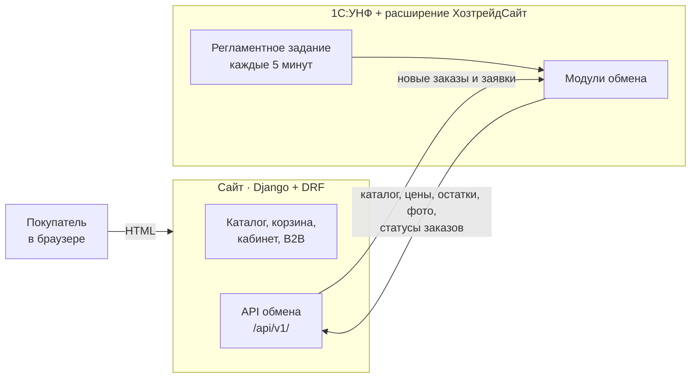

# Хозтрейд: интернет-магазин + 1С:УНФ + двусторонний обмен

Инициативный проект для группы компаний «Хозтрейд» (Чебоксары, стройматериалы). Готовое решение из трёх
частей:

- **сайт** на Django: каталог, корзина, оформление заказа для частных лиц и компаний, личный кабинет,
  оптовые цены для подтверждённых компаний, заявки «обратный звонок» и «заказ по смете»;
- **расширение 1С:УНФ** `ХозтрейдСайт`: типовая конфигурация не меняется, всё — в расширении;
- **обмен по REST/JSON**: 1С выгружает каталог, цены, остатки и фото, забирает заказы и заявки, возвращает
  статусы заказов и итог по счёту. Работает по расписанию и по кнопке.

Всё запускается на одном компьютере: сайт на `localhost:8000`, учебная УНФ в файловом режиме.

## Архитектура



**Обмен всегда начинает 1С.** В реальной компании 1С стоит в офисе за NAT, а сайт — в интернете: 1С не нужно
публиковать наружу, а для переноса в бой меняется только адрес сайта в настройке обмена.

| Кто главный | Данные |
|---|---|
| 1С | каталог, цены (розница и опт), остатки, фото товаров, статусы и итоговые суммы заказов |
| Сайт | веб-заказы, заявки (обратный звонок, заказ по смете), покупатели и заявки компаний на опт |

Один цикл обмена (`хт_ОбменССайтом.ВыполнитьОбмен`):

1. `GET /orders/new/` → «Заказ покупателя» в УНФ (контрагент по ИНН / телефону / email, вид цен — розничный
   или оптовый, доставка грузотакси в типовых реквизитах) → `POST /orders/ack/`.
2. `GET /leads/new/` → типовой «Лид» с приложенным файлом сметы → `POST /leads/ack/`.
3. `POST /orders/status/` — изменившиеся состояния заказов и сумма документа (с автоскидками УНФ).
4. `POST /catalog/` — полная выгрузка групп, товаров, цен и остатков; сайт отвечает, какие фото обновить,
   и 1С отправляет только их (`PUT /products/<id>/image/`).

Пока 1С не подтвердила получение, заказ отдаётся снова — сбой посередине ничего не теряет, а повторная
загрузка не создаёт дублей. Контракт API — [docs/api.md](docs/api.md).

## Что сделано

**Сайт** (`site/`, Python 3.12, Django 5.2, DRF)
- каталог: дерево разделов из 1С, мегаменю, фильтры по цене и наличию, сортировка, поиск по кириллице,
  ЧПУ-адреса (транслит), schema.org, `sitemap.xml`, `robots.txt`;
- корзина с подбором грузотакси по весу заказа (1,5–20 т), оформление: частное лицо или организация
  (проверка контрольной суммы ИНН), самовывоз из трёх точек или доставка;
- страница статуса заказа по ссылке: шаги, номер в 1С, скидка и итог по счёту из 1С;
- личный кабинет: регистрация по email, история заказов со статусами из 1С, повтор заказа, смена и
  восстановление пароля;
- **B2B**: компания запрашивает оптовые цены, менеджер подтверждает в админке — в каталоге, корзине и заказе
  оптовые цены, заказ всегда оформляется на компанию из профиля;
- «Заказ по смете» (файл или фото), «Обратный звонок»; защита форм: согласие 152-ФЗ, поле-ловушка, лимит
  отправок с одного адреса, CSRF; письма менеджерам;
- боевой режим: `DEBUG=False`, waitress, статика через whitenoise, `check --deploy` без замечаний.

**Расширение 1С** (`1c/src/`, УНФ 3.0.13, платформа 8.5 учебная)
- справочник «Настройки обмена с сайтом»: адрес, виды цен (розница / опт), группы номенклатуры, склады,
  «только товары с ценой»; **токен обмена — в безопасном хранилище БСП** (команда «Задать токен обмена»);
- регламентное задание «Обмен с сайтом Хозтрейд» (каждые 5 минут) и команды раздела «Сайт»;
- журнал обмена (регистр сведений) и регистр соответствий «объект сайта ↔ документ 1С»;
- заказы с сайта → «Заказ покупателя» с проверкой остатков (с группировкой по номенклатуре), заявки → «Лиды»;
- демо-данные: команда «Заполнить демо-каталог Хозтрейд» (63 товара, цены, остатки, фото, настройка обмена).

## Запуск за 5 минут

### Сайт без 1С

```bat
cd site
python -m venv .venv
.venv\Scripts\pip install -r requirements.txt
copy .env.example .env
.venv\Scripts\python manage.py migrate
.venv\Scripts\python manage.py load_demo_catalog
.venv\Scripts\python manage.py load_demo_accounts
.venv\Scripts\python manage.py createsuperuser
run-dev.bat
```

В `.env` заменить `SECRET_KEY` и `EXCHANGE_TOKEN` на случайные строки. Сайт — <http://localhost:8000>,
админка — `/admin/`. Демо-покупатели (пароль `hoztrade-demo`): `demo@hoztrade.local` — частное лицо,
`snab@hoztrade.local` — компания с подтверждёнными оптовыми ценами.

Боевой режим — `run-prod.bat` (миграции, collectstatic, waitress на `127.0.0.1:8000`; другой порт —
аргументом: `run-prod.bat 8001`).

### 1С

1. Учебная платформа 8.5 и демо-база «Управление нашей фирмой» 3.0. Скопировать базу в папку вне OneDrive.
2. `1c\.1c-devbase.ps1.example` → `1c\.1c-devbase.ps1`, указать путь к базе и пользователя.
3. Закрыть Конфигуратор и 1С, запустить `1c\load.bat` — расширение загрузится и применится к базе.
4. В 1С снять безопасный режим расширения (он запрещает HTTP): Shift+F11 → `e1cib/app/ОбщаяФорма.Расширения`
   → снять флажок «Безопасный режим» у `ХозтрейдСайт` → перезапустить.
5. Раздел **«Сайт» → «Заполнить демо-каталог Хозтрейд»**. Открыть «Настройки обмена с сайтом» →
   **«Задать токен обмена»** (значение `EXCHANGE_TOKEN` из `site\.env`) → **«Проверить связь с сайтом»**.
6. **«Обмен с сайтом»** — каталог с фото появится на сайте. Дальше обмен идёт сам каждые 5 минут, пока открыт
   клиент 1С (в файловой базе регламентные задания выполняет клиентский сеанс).

## Демо-сценарий

1. На сайте войти как `snab@hoztrade.local`: в каталоге оптовые цены, розничные зачёркнуты.

   

2. Положить товары в корзину и оформить заказ — он оформляется на компанию из профиля по оптовым ценам.
3. Через несколько минут регламентный обмен создаёт в УНФ «Заказ покупателя»: покупатель найден по ИНН,
   вид цен «Оптовая», номер сайта — во входящем номере, состояние «Обсуждение КП».

   

4. Менеджер проводит заказ и меняет состояние, например на «На складе». Следующий обмен отправляет статус —
   покупатель видит его в личном кабинете и на странице заказа.

   

5. Каждая операция обмена — в журнале обмена (раздел «Сайт»).

   

Заказ физлица с доставкой грузотакси: 

## Тесты

```bat
cd site
.venv\Scripts\python -m pytest -q
```

Покрыты: импорт каталога и фото, API обмена (токен, заказы, заявки, статусы), корзина и оформление, ИНН,
защита форм, личный кабинет, оптовые цены, sitemap. Расширение проверяется загрузкой (`load.bat` — загрузка,
обновление БД, синтаксический контроль модулей) и сквозным прогоном в живой УНФ.

## Структура

```
site/            Django-проект: catalog, orders, accounts (кабинет и B2B), exchange (API для 1С), pages
1c/src/          исходники расширения ХозтрейдСайт (XML + BSL, формат Hierarchical)
1c/tools/        загрузка/выгрузка расширения, генератор демо-картинок
docs/api.md      контракт API обмена
docs/screenshots скриншоты для README
```

## Решения и альтернативы

- **Свой REST вместо CommerceML.** В УНФ есть штатный обмен с интернет-магазином по CommerceML. Свой API проще
  расширять (B2B, статусы с суммой, фото по запросу) и он не зависит от учётной системы: если у «Хозтрейда»
  не УНФ, переписывается только адаптер в 1С, сайт и API остаются.
- **Учебная платформа.** Один сеанс, до 2000 записей в таблице, файловый режим. Поэтому регламентное задание
  выполняется только при открытом клиенте; в рабочей базе (клиент-сервер) — на сервере 1С без участия
  пользователя.
- **Перенос в бой:** сайт — `HTTPS=True`, `ALLOWED_HOSTS`, PostgreSQL через `DATABASE_URL`, SMTP; в 1С —
  адрес сайта в настройке обмена.
