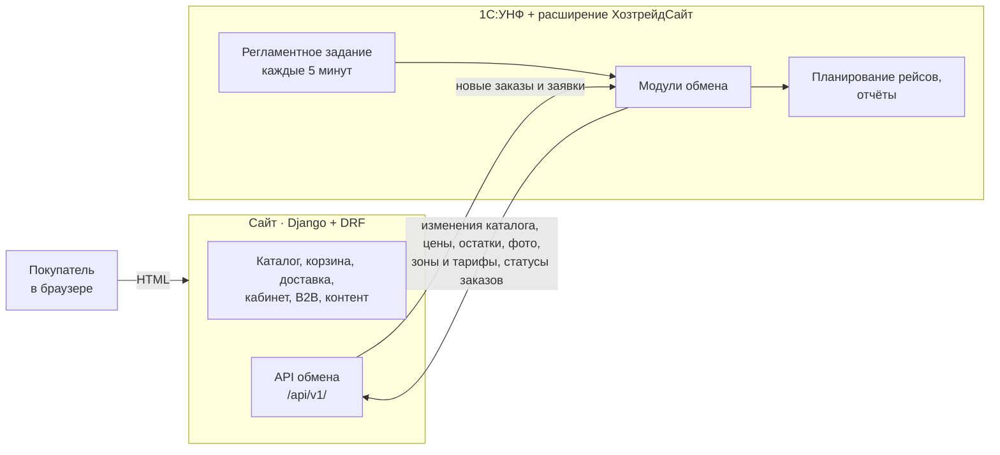
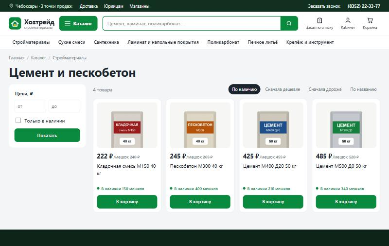
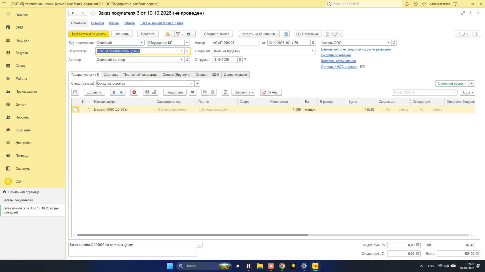
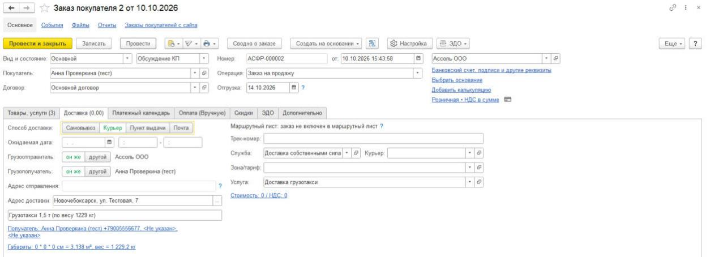
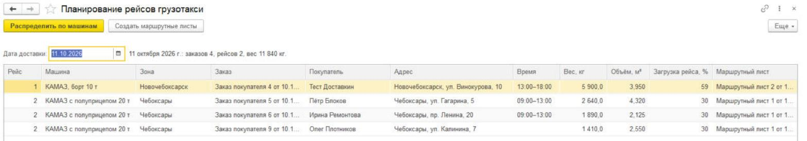
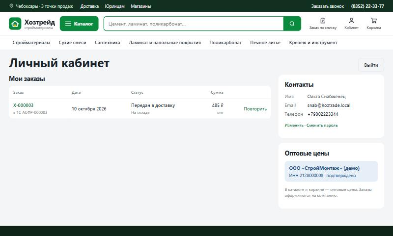
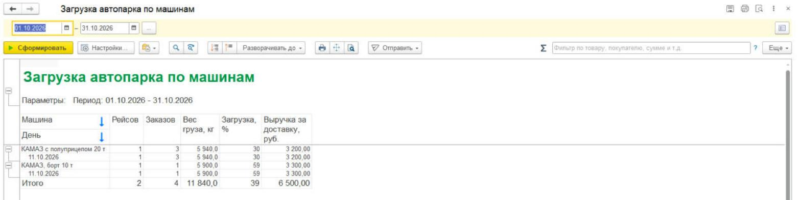
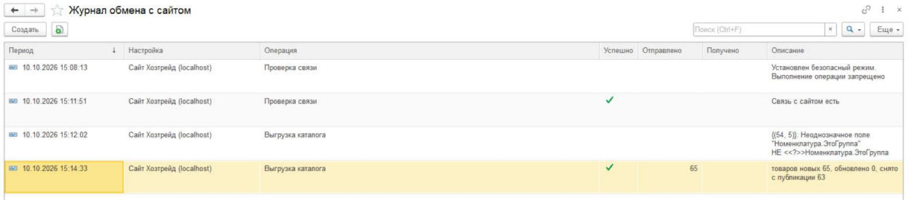

# Хозтрейд: интернет-магазин + 1С:УНФ + двусторонний обмен

Инициативный проект для группы компаний «Хозтрейд» (Чебоксары, стройматериалы). Готовое решение из трёх
частей:

- **сайт** на Django: каталог, корзина, оформление с расчётом доставки грузотакси по зонам, личный кабинет,
  оптовые цены для подтверждённых компаний, заявки «обратный звонок» и «заказ по смете», акции, новости,
  бренды и отзывы с модерацией;
- **расширение 1С:УНФ** `ХозтрейдСайт`: типовая конфигурация не меняется, всё — в расширении. Обмен с сайтом,
  тарифы грузотакси, планирование рейсов с маршрутными листами, отчёты;
- **обмен по REST/JSON**: 1С выгружает каталог (только изменения), цены, остатки, фото, зоны и тарифы доставки,
  забирает заказы и заявки, возвращает статусы заказов и итог по счёту. Работает по расписанию и по кнопке.

Всё запускается на одном компьютере: сайт на `localhost:8000`, учебная УНФ в файловом режиме.

## Архитектура



**Обмен всегда начинает 1С.** В реальной компании 1С стоит в офисе за NAT, а сайт — в интернете: 1С не нужно
публиковать наружу, а для переноса в бой меняется только адрес сайта в настройке обмена.

| Кто главный | Данные |
|---|---|
| 1С | каталог, цены (розница и опт), остатки, фото, зоны доставки, автопарк и тарифы, статусы и суммы заказов |
| Сайт | веб-заказы, заявки, покупатели и заявки компаний на опт, контент: акции, новости, бренды, отзывы |

Один цикл обмена (`хт_ОбменССайтом.ВыполнитьОбмен`):

1. `GET /orders/new/` → «Заказ покупателя» в УНФ: контрагент по ИНН / телефону / email, вид цен (розница или
   опт), доставка в типовых реквизитах — зона, стоимость по тарифу с НДС, интервал, машина и рейсы, вес и
   объём → `POST /orders/ack/`.
2. `GET /leads/new/` → типовой «Лид» с приложенным файлом сметы → `POST /leads/ack/`.
3. `POST /orders/status/` — изменившиеся состояния заказов и сумма документа (с доставкой и автоскидками УНФ).
4. `POST /delivery/` — зоны, машины и тарифы, только если изменились.
5. `POST /catalog/` — **только изменённые** группы и товары (хеш каждого товара вместе с ценой, остатком и
   версией фото хранится в регистре `хт_ВерсииНаСайте`), снятое с продажи — списком `removed`. Нет изменений —
   запроса к сайту нет. Сайт просит прислать только изменившиеся фото (`PUT /products/<id>/image/`).

Пока 1С не подтвердила получение, заказ отдаётся снова — сбой посередине ничего не теряет, а повторная
загрузка не создаёт дублей. Если сайт потерял данные (новая база), 1С замечает это по числу товаров и сама
делает полную выгрузку. Контракт API — [docs/api.md](docs/api.md).

## Что сделано

**Сайт** (`site/`, Python 3.12, Django 5.2, DRF)
- каталог: дерево разделов из 1С, мегаменю, фильтры по цене, наличию и **брендам**, сортировка, поиск по
  кириллице с ранжированием (совпадение с начала названия выше), рейтинг и число отзывов на карточках,
  ЧПУ-адреса (транслит), schema.org, canonical, Open Graph, `sitemap.xml`, `robots.txt`;
- **доставка грузотакси**: зоны, автопарк и тарифы приходят из 1С. Корзина подбирает наименьшую машину,
  которая увезёт заказ по весу и объёму (или несколько рейсов самой большой), при оформлении видна стоимость
  доставки в каждую зону, выбирается интервал. Страница «Доставка» — таблица тарифов и калькулятор;
- оформление: частное лицо или организация (проверка контрольной суммы ИНН), самовывоз из трёх точек или
  доставка; страница статуса заказа по ссылке: шаги, номер в 1С, доставка, скидка и итог по счёту из 1С;
- личный кабинет: регистрация по email, история заказов со статусами из 1С, повтор заказа, смена и
  восстановление пароля;
- **B2B**: компания запрашивает оптовые цены, менеджер подтверждает в админке — в каталоге, корзине и заказе
  оптовые цены, заказ всегда оформляется на компанию из профиля;
- **контент**: акции со сроком действия, новости и советы, бренды (товары из 1С привязываются к бренду по
  названию), отзывы о товарах с модерацией и ответом магазина (schema.org AggregateRating), страницы
  «О компании», «Оплата», «Контакты» с картой, политика cookie и плашка о cookie;
- «Заказ по смете» (файл или фото), «Обратный звонок»; защита форм: согласие 152-ФЗ, поле-ловушка, лимит
  отправок с одного адреса, CSRF; уведомления менеджерам на почту и **в Telegram** (по желанию);
- боевой режим: `DEBUG=False`, waitress, статика через whitenoise, `check --deploy` без замечаний,
  заголовки CSP и Permissions-Policy (только свои скрипты и стили, без встроенных обработчиков);
- производительность: дерево каталога кэшируется до обмена с 1С (страница раздела — 6 запросов к базе),
  расчёт доставки по всем зонам — 3 запроса, фото из 1С ужимаются в WebP (до 1600 px) с миниатюрой 480 px
  для списков (`manage.py rebuild_thumbs` — для уже загруженных), `sitemap.xml` кэшируется на час.

**Расширение 1С** (`1c/src/`, УНФ 3.0.13, платформа 8.5 учебная)
- справочник «Настройки обмена с сайтом»: адрес, виды цен (розница / опт), группы номенклатуры, склады,
  «только товары с ценой»; **токен обмена — в безопасном хранилище БСП** (команда «Задать токен обмена»);
- регламентное задание «Обмен с сайтом Хозтрейд» (каждые 5 минут) и команды раздела «Сайт»;
- выгрузка каталога только изменений (регистр `хт_ВерсииНаСайте`), полная — командой «Выгрузить каталог на
  сайт»; журнал обмена пишет только операции, которые что-то передали, и чистит записи старше 30 дней;
- заказы с сайта → «Заказ покупателя» с проверкой остатков (с группировкой по номенклатуре) и заполненной
  доставкой, заявки → «Лиды»;
- **тарифы грузотакси** (регистр `хт_ТарифыДоставки`: зона × машина → стоимость рейса) на типовых справочниках
  «Зоны и тарифы доставки» и «Транспортные средства»;
- **обработка «Планирование рейсов грузотакси»**: заказы с доставкой на дату распределяются по рейсам внутри
  зоны и интервала, тяжёлые первыми; каждому рейсу — наименьшая машина, которая увезёт груз, с процентом
  загрузки; диспетчер может сменить машину. Кнопка «Сохранить маршрутные листы» создаёт типовые
  **маршрутные листы** (водитель — из последнего листа этой машины) и меняет машину в уже созданных
  непроведённых; если груза в листе стало меньше, обработка подскажет машину поменьше. Проведение листа
  переводит заказы в состояние доставки, и сайт показывает покупателю «Передан в доставку»;
- **отчёты СКД**: «Продажи с сайта» (по дням, покупателям, способу получения), «Воронка заявок с сайта»
  (получено → в работе → успешно, конверсия), «Загрузка автопарка» (рейсы, вес, загрузка, выручка за доставку);
- демо-данные: команда «Заполнить демо-каталог Хозтрейд» — 299 товаров в 8 разделах, цены, остатки, фото,
  4 зоны, 5 машин, 20 тарифов, включение маршрутных листов, настройка обмена.

## Запуск за 5 минут

### Сайт без 1С

```bat
cd site
python -m venv .venv
.venv\Scripts\pip install -r requirements.txt
copy .env.example .env
.venv\Scripts\python manage.py migrate
.venv\Scripts\python manage.py load_demo_catalog
.venv\Scripts\python manage.py load_demo_content
.venv\Scripts\python manage.py load_demo_accounts
.venv\Scripts\python manage.py createsuperuser
run-dev.bat
```

В `.env` заменить `SECRET_KEY` и `EXCHANGE_TOKEN` на случайные строки. Сайт — <http://localhost:8000>,
админка — `/admin/` (модерация отзывов, акции и новости, бренды). Демо-покупатели (пароль `hoztrade-demo`):
`demo@hoztrade.local` — частное лицо, `snab@hoztrade.local` — компания с подтверждёнными оптовыми ценами.

`load_demo_catalog` загружает каталог и тарифы тем же импортом, что и 1С; если каталог уже приходит из 1С,
команда его не трогает (`--force` — загрузить поверх). Уведомления в Telegram: `TELEGRAM_BOT_TOKEN` и
`TELEGRAM_CHAT_ID` в `.env`.

Боевой режим — `run-prod.bat` (миграции, collectstatic, waitress на `127.0.0.1:8000`; другой порт —
аргументом: `run-prod.bat 8001`).

### 1С

1. Учебная платформа 8.5 и демо-база «Управление нашей фирмой» 3.0. Скопировать базу в папку вне OneDrive.
2. `1c\.1c-devbase.ps1.example` → `1c\.1c-devbase.ps1`, указать путь к базе и пользователя.
3. Закрыть Конфигуратор и 1С, запустить `1c\load.bat` — расширение загрузится и применится к базе.
4. В 1С снять безопасный режим расширения (он запрещает HTTP): Shift+F11 → `e1cib/app/ОбщаяФорма.Расширения`
   → снять флажок «Безопасный режим» у `ХозтрейдСайт` → перезапустить.
5. Раздел **«Сайт» → «Заполнить демо-каталог Хозтрейд»** (около двух минут). Открыть «Настройки обмена с
   сайтом» → **«Задать токен обмена»** (значение `EXCHANGE_TOKEN` из `site\.env`) → **«Проверить связь»**.
6. **«Выгрузить каталог на сайт»** — каталог с фото и тарифы доставки появятся на сайте. Дальше обмен идёт сам
   каждые 5 минут, пока открыт клиент 1С (в файловой базе регламентные задания выполняет клиентский сеанс).

## Демо-сценарий

1. На сайте войти как `snab@hoztrade.local`: в каталоге оптовые цены, розничные зачёркнуты.

   

2. Положить товары в корзину: сайт подберёт машину по весу и объёму. При оформлении выбрать доставку, зону и
   интервал — стоимость рейса по тарифу из 1С сразу видна в итоге.
3. Через несколько минут регламентный обмен создаёт в УНФ «Заказ покупателя»: покупатель найден по ИНН,
   вид цен «Оптовая», номер сайта — во входящем номере, состояние «Обсуждение КП», на вкладке «Доставка» —
   зона, стоимость, интервал и машина.

   

   

4. Диспетчер открывает «Планирование рейсов грузотакси» на завтра: заказы разложены по рейсам и машинам,
   «Создать маршрутные листы» — и рейсы готовы к отправке.

   

5. Проведённый маршрутный лист переводит заказы в доставку — следующий обмен отправляет статус, покупатель
   видит его в личном кабинете и на странице заказа.

   

6. Отчёты раздела «Сайт»: продажи, воронка заявок, загрузка автопарка. Каждая операция обмена — в журнале.

   

   

## Тесты

```bat
cd site
.venv\Scripts\python -m pytest -q
```

85 тестов: импорт каталога и выгрузка изменений, фото, API обмена (токен, заказы, заявки, статусы, доставка),
расчёт машины и стоимости доставки, корзина и оформление, ИНН, защита форм, личный кабинет, оптовые цены,
публикации, отзывы и модерация, бренды и фильтр по ним, рейтинг, поиск, кэш дерева каталога, миниатюры фото,
CSP и SEO-метатеги, Telegram, sitemap. Расширение проверяется загрузкой (`load.bat` —
загрузка, обновление БД, синтаксический контроль модулей), обратной выгрузкой (формы) и сквозным прогоном в
живой УНФ.

## Структура

```
site/             Django-проект: catalog (+ бренды), orders, delivery (зоны, автопарк, расчёт),
                  content (акции, новости, отзывы), accounts (кабинет и B2B), exchange (API для 1С), pages
1c/src/           исходники расширения ХозтрейдСайт (XML + BSL, формат Hierarchical)
1c/tools/         загрузка/выгрузка расширения, генераторы демо-данных и картинок, skd/ — исходники схем СКД
docs/api.md       контракт API обмена
docs/screenshots  скриншоты для README
```

Демо-данные для сайта и 1С — из одного источника: `site/catalog/demo_data*.py` и `site/delivery/demo_data.py`;
`1c/tools/make_demo_data.py` пишет из них макеты расширения `хт_ДемоКаталог` и `хт_ДемоДоставка`.

## Решения и альтернативы

- **Свой REST вместо CommerceML.** В УНФ есть штатный обмен с интернет-магазином по CommerceML. Свой API проще
  расширять (B2B, доставка по тарифам, статусы с суммой, фото по запросу, выгрузка изменений) и он не зависит
  от учётной системы: если у «Хозтрейда» не УНФ, переписывается только адаптер в 1С, сайт и API остаются.
- **Изменения по хешам, а не планом обмена.** Хеш данных товара (вместе с ценой и остатком) ловит изменение из
  любого источника — правку карточки, новую цену, любой документ движения — без подписок на события.
- **Доставка на типовых объектах.** Зоны, машины, способ доставки, маршрутные листы — типовые УНФ; расширение
  добавляет только тарифы и алгоритм. Менеджер работает в привычных формах.
- **Учебная платформа.** Один сеанс, до 2000 записей в таблице, файловый режим. Поэтому регламентное задание
  выполняется только при открытом клиенте; в рабочей базе (клиент-сервер) — на сервере 1С без участия
  пользователя. Журнал обмена не разрастается: пустые циклы не пишутся.
- **Перенос в бой:** сайт — `HTTPS=True`, `ALLOWED_HOSTS`, PostgreSQL через `DATABASE_URL`, SMTP, Telegram;
  в 1С — адрес сайта в настройке обмена. Тексты политики ПДн и cookie — шаблоны, их утверждает юрист.
